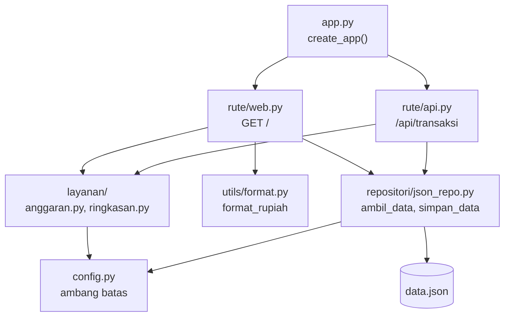
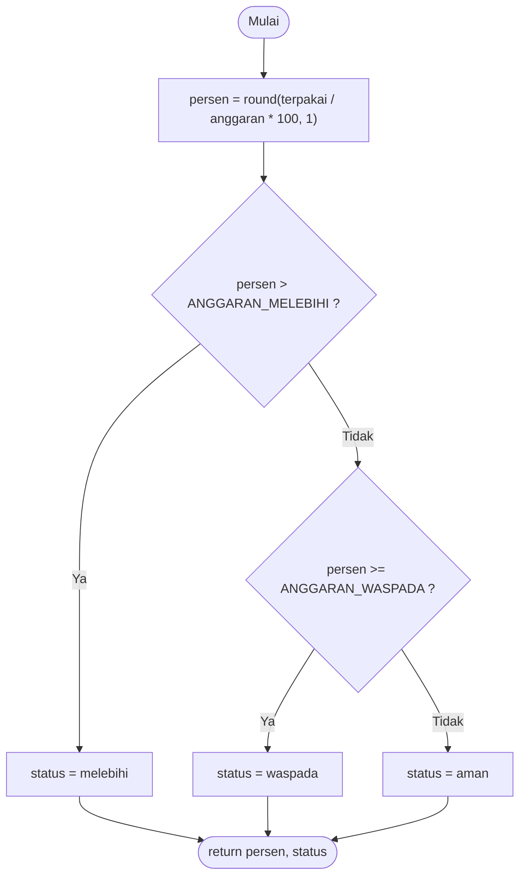
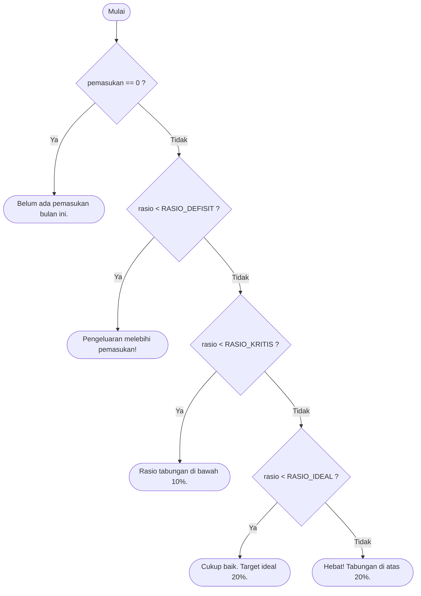
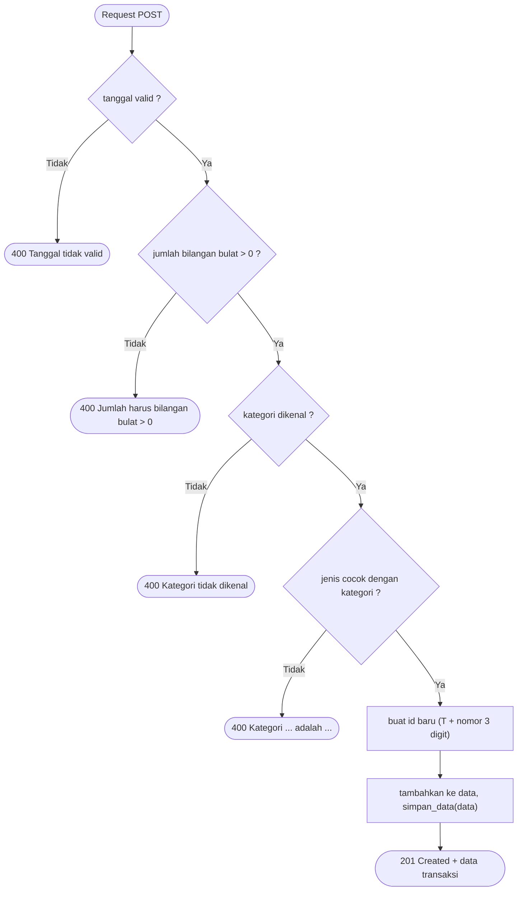
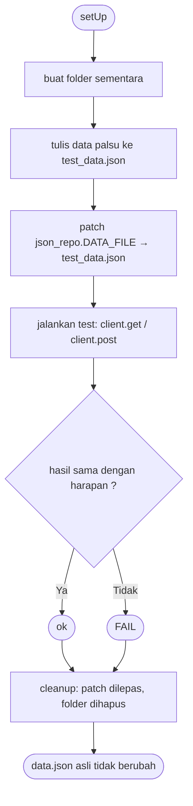

# Reverse Keuangan Mahasiswa — Unit Test & Integration Test

Aplikasi pencatat keuangan mahasiswa berbasis **Flask** yang sudah dimodularisasi
(rute, layanan, repositori, utils), lengkap dengan **unit test** dan **integration test**
memakai `unittest` bawaan Python.

## Struktur Proyek

```
.
├── app.py                  # create_app(): membuat Flask app + mendaftarkan blueprint
├── config.py               # path data.json + ambang batas (rasio & anggaran)
├── data.json               # data transaksi dan kategori
├── layanan/                # logika bisnis
│   ├── anggaran.py         # hitung_status_anggaran
│   └── ringkasan.py        # hitung_ringkasan_keuangan, tentukan_nasihat
├── repositori/
│   └── json_repo.py        # ambil_data, simpan_data (baca/tulis JSON)
├── rute/
│   ├── web.py              # blueprint halaman web (GET /)
│   └── api.py              # blueprint REST API (/api/transaksi)
├── utils/
│   └── format.py           # format_rupiah
├── templates/              # tampilan HTML
└── tests/
    ├── __init__.py
    ├── test_layanan.py     # unit test
    ├── test_utils.py       # unit test
    ├── test_repositori.py  # integration test
    └── test_rute.py        # integration test
```

## Arsitektur Modular

Setiap lapisan hanya memanggil lapisan di bawahnya, sehingga tiap bagian bisa diuji terpisah.



## Menjalankan

```bash
pip install -r requirements.txt

# Jalankan aplikasi web
python app.py            # buka http://127.0.0.1:5000

# Semua test
python -m unittest discover -s tests -t . -v

# Per file
python -m unittest tests.test_layanan -v
python -m unittest tests.test_utils -v
python -m unittest tests.test_repositori -v
python -m unittest tests.test_rute -v
```

> Jalankan test selalu dengan `python -m unittest ...` dari folder utama proyek,
> bukan dengan tombol Run di editor, agar modul `layanan`, `utils`, dan lainnya ditemukan.

## Jenis Pengujian

| File test | Jenis | Yang diuji | Jumlah |
|---|---|---|---|
| `tests/test_layanan.py` | Unit test | `layanan/anggaran.py`, `layanan/ringkasan.py` | 15 |
| `tests/test_utils.py` | Unit test | `utils/format.py` | 8 |
| `tests/test_repositori.py` | Integration test | `repositori/json_repo.py` + file JSON sementara | 7 |
| `tests/test_rute.py` | Integration test | `rute/api.py`, `rute/web.py` + repositori + layanan | 13 |
| | | **Total** | **43** |

- **Unit test**: menguji satu fungsi secara terpisah (input → output), tanpa file dan tanpa Flask.
- **Integration test**: menguji beberapa modul yang bekerja bersama. Data asli `data.json`
  tidak disentuh karena `DATA_FILE` diganti ke file sementara dengan `unittest.mock.patch`.

## Alur Logika (Flowchart)

### 1. `hitung_status_anggaran(terpakai, anggaran)`



Contoh: `hitung_status_anggaran(150000, 200000)` → persen 75.0 → `waspada`.

### 2. `tentukan_nasihat(pemasukan, rasio)`



### 3. `POST /api/transaksi` (tambah transaksi)



### 4. Cara kerja integration test (`@patch` DATA_FILE)



## Skenario Pengujian

> **Input ditolak ≠ test gagal.** Jika kode memang seharusnya menolak input (mengembalikan
> `False`, status 400, atau melempar error) dan test mengharapkan hal itu, status test tetap `ok`.

### Unit test — `tests/test_layanan.py` (15 test)

| Kelas | Test | Input | Hasil yang diharapkan |
|---|---|---|---|
| `TestAnggaranBatas` | `test_persen_dan_status_aman` | `(10000, 200000)` | `(5.0, "aman")` |
| | `test_nol_terpakai` | `(0, 200000)` | `(0.0, "aman")` |
| | `test_batas_waspada` | `(150000, 200000)` | `(75.0, "waspada")` |
| | `test_tepat_100_persen_masih_waspada` | `(200000, 200000)` | `(100.0, "waspada")` |
| | `test_melebihi` | `(250000, 200000)` | `(125.0, "melebihi")` |
| | `test_anggaran_nol` | `(1000, 0)` | `ZeroDivisionError` |
| `TestRingkasan` | `test_ringkasan_normal` | pemasukan 1.000.000, pengeluaran 600.000 | `(1000000, 600000, 400000, 40.0)` |
| | `test_ringkasan_pembulatan` | pemasukan 300.000, pengeluaran 200.000 | rasio `33.3` |
| | `test_ringkasan_data_kosong` | `[]` | `(0, 0, 0, 0)` |
| | `test_ringkasan_tanpa_pemasukan` | hanya pengeluaran 50.000 | `(0, 50000, -50000, 0)` |
| `TestNasihat` | `test_tanpa_pemasukan` | `(0, 0)` | "Belum ada pemasukan ..." |
| | `test_defisit` | rasio `-5` | "... melebihi ..." |
| | `test_kritis` | rasio `5` | "... di bawah 10% ..." |
| | `test_cukup_baik` | rasio `15` | "Cukup baik ..." |
| | `test_hebat` | rasio `25` | "Hebat ..." |

### Unit test — `tests/test_utils.py` (8 test)

| Test | Input | Hasil yang diharapkan |
|---|---|---|
| `test_jutaan` | `1500000` | `"Rp 1.500.000"` |
| `test_ribuan` | `1000` | `"Rp 1.000"` |
| `test_di_bawah_seribu_tanpa_titik` | `999` | `"Rp 999"` |
| `test_nol` | `0` | `"Rp 0"` |
| `test_miliaran` | `1000000000` | `"Rp 1.000.000.000"` |
| `test_angka_negatif` | `-3000` | `"Rp -3.000"` |
| `test_input_string_ditolak` | `"abc"` | `ValueError` |
| `test_input_none_ditolak` | `None` | `TypeError` |

### Integration test — `tests/test_repositori.py` (7 test)

| Test | Langkah | Hasil yang diharapkan |
|---|---|---|
| `test_simpan_lalu_ambil` | simpan data, lalu ambil | data sama persis |
| `test_simpan_membuat_file` | simpan ke path yang belum ada | file terbentuk |
| `test_simpan_menimpa_data_lama` | simpan dua kali | data terakhir yang tersimpan |
| `test_data_kosong` | simpan `[]` | ambil → `[]` |
| `test_karakter_unicode_tidak_diubah` | simpan teks dengan karakter non-ASCII | tersimpan apa adanya |
| `test_ambil_file_tidak_ada` | ambil tanpa file | `FileNotFoundError` |
| `test_ambil_json_rusak` | ambil dari file JSON rusak | `json.JSONDecodeError` |

### Integration test — `tests/test_rute.py` (13 test)

| Kelas | Test | Hasil yang diharapkan |
|---|---|---|
| `TestApiGet` | `test_get_transaksi_per_bulan` | 200, hanya transaksi bulan itu |
| | `test_get_transaksi_bulan_lain` | 200, transaksi bulan lain |
| | `test_get_transaksi_bulan_kosong` | 200, `[]` |
| `TestApiPost` | `test_post_valid` | 201, id `T004` |
| | `test_post_valid_tersimpan` | jumlah transaksi bertambah |
| | `test_post_tanggal_tidak_valid` | 400, "Tanggal tidak valid" |
| | `test_post_jumlah_nol` | 400, "Jumlah harus bilangan bulat > 0" |
| | `test_post_jumlah_bukan_angka` | 400 |
| | `test_post_kategori_tidak_dikenal` | 400, "Kategori tidak dikenal" |
| | `test_post_jenis_tidak_cocok_kategori` | 400, "Kategori Makanan adalah pengeluaran" |
| | `test_post_ditolak_tidak_mengubah_data` | data tetap |
| `TestHalamanWeb` | `test_halaman_utama` | 200 |
| | `test_halaman_utama_bulan_tanpa_data` | 200 |

## Hasil Pengujian

```
python -m unittest discover -s tests -t .

Ran 43 tests in 0.197s

OK
```

| Status | Arti |
|---|---|
| `ok` | Hasil sesuai ekspektasi |
| `FAIL` | Assertion tidak terpenuhi (hasil ≠ ekspektasi) |
| `ERROR` | Terjadi exception tak terduga sebelum assertion selesai |

## Temuan Selama Pengujian

1. **Bug skala di `config.py`.** `persen` dan `rasio` dihitung dalam skala 0–100, tetapi konstanta
   (`ANGGARAN_WASPADA`, `ANGGARAN_MELEBIHI`, `RASIO_*`) semula berskala 0–1. Akibatnya
   `test_status_aman` **FAIL** (`'melebihi' != 'aman'`) karena `5.0 > 1.0`. Setelah konstanta
   disesuaikan ke skala 0–100, seluruh test lulus.
2. **`format_rupiah` dengan angka desimal.** `format_rupiah(1500.5)` menghasilkan `"Rp 1.500.5"`
   (dua titik). Fungsi ini dirancang untuk bilangan bulat, sehingga kasus ini belum dites dan dicatat sebagai
   batasan.
3. **Anggaran 0.** `hitung_status_anggaran(x, 0)` melempar `ZeroDivisionError`. Perilaku ini
   dikunci oleh `test_anggaran_nol`; jika nanti ditangani dengan `try/except`, test perlu disesuaikan.

## Cara Membuat Test Gagal (Simulasi)

Untuk melihat unit test mendeteksi bug, ubah sementara kode, jalankan test, lalu kembalikan.

```python
# layanan/anggaran.py — ubah > menjadi >=
if persen >= ANGGARAN_MELEBIHI:   # bug disengaja
```

Jalankan `python -B -m unittest tests.test_layanan -v`. `test_tepat_100_persen_masih_waspada`
akan **FAIL** karena 100% kini dianggap `melebihi`. Saat test gagal, periksa dua kemungkinan:
**kodenya yang salah**, atau **ekspektasi test-nya yang salah**.